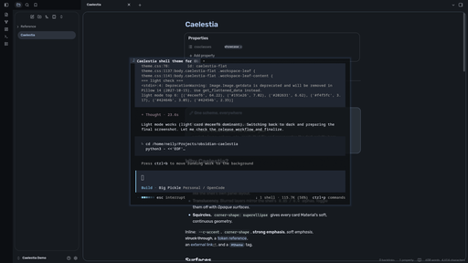

# Caelestia — an Obsidian theme

[](https://github.com/alliseeislight/obsidian-caelestia/releases)
[](LICENSE)

**Material 3 / Material You, straight from the [Caelestia](https://github.com/caelestia-dots/shell) desktop shell to Obsidian.**

If you run Caelestia, this is the missing piece — your notes finally match your
bar, launcher, dashboard, and lock screen. Rounded, tonal, blurred, and driven by
the same design tokens the shell uses.



## Features

- **Faithful Material 3 palette** — the light and dark schemes are generated
  from a real Caelestia colour scheme, with full tonal surfaces
  (`surface-container-lowest` → `surface-highest`).
- **Caelestia's exact design tokens** — rounding `4 / 8 / 12 / 16 / 20 / 28 / 32
  / 48 / full`, the shell's spacing scale, and Material's emphasized easing.
- **Squircle corners** — uses CSS `corner-shape: superellipse` for that Material
  expressive look (falls back gracefully on older builds).
- **Translucent + blurred** popovers, menus, and modals, mirroring the shell's
  `transparency.base` / `layers` settings.
- **Floating panes** — sidebars and note panes become rounded cards on a mantle
  background.
- **Bundled Rubik** (SIL OFL) so the theme looks right even without Google Sans
  Flex installed.
- **Style Settings support** — switch accent role, corner rounding, corner shape,
  translucency, flat/floating panes, and reading width without touching CSS.
- **Complete coverage** — editor, reading view, callouts, embeds, tables, code,
  properties, tags, Bases (1.9+), Canvas, and graph.
- **Sync script** — regenerate the palette from your live Caelestia scheme with
  one command.
-**Persistant Sync** — Run the script to install a system service that will peristantly run to sync Obsidian with your scheme, perists after reboot

## Installation

### From the community store

> Pending review — once published you can find it under
> **Settings → Appearance → Manage → Browse → Themes → Caelestia**.

### Manually

1. Download `theme.css` and `manifest.json` (or clone this repo).
2. Create a folder called `Caelestia` in your vault's `.obsidian/themes/`
   directory:

   ```sh
   mkdir -p "<your vault>/.obsidian/themes/Caelestia"
   cp theme.css manifest.json "<your vault>/.obsidian/themes/Caelestia/"
   cp -r fonts "<your vault>/.obsidian/themes/Caelestia/"
   ```

3. Open **Settings → Appearance → Themes** and select **Caelestia**.

> The `fonts/` folder is optional but recommended — without it the theme falls
> back to your system sans-serif.

### For the closest match to your shell

Caelestia's UI face is **Google Sans Flex**. It isn't redistributable, so the
theme falls back to the bundled **Rubik** and then your system font. If you have
Google Sans Flex installed, the theme picks it up automatically.

## Style Settings

Install [Style Settings](https://github.com/mgmeyers/obsidian-style-settings)
to unlock:

| Setting | Options |
| --- | --- |
| **Accent** | Primary · Secondary · Tertiary |
| **Corner rounding** | Caelestia · Pill · Square |
| **Corner shape** | Squircle · Round |
| **Opaque surfaces** | Disable blur/translucency |
| **Floating panes** | Detached rounded cards |
| **Reading width** | 560 – 1200px |

## Syncing with your live scheme

Caelestia writes its active colours to
`~/.local/state/caelestia/scheme.json`. Regenerate the theme palette from it:

```sh
node scripts/sync-scheme.mjs                       # live scheme, auto-detect mode
node scripts/sync-scheme.mjs --mode light scheme.json
node scripts/sync-scheme.mjs ~/.cache/caelestia/schemes/<id>/content/default/dark.json
```

**Keep it in sync automatically:**
```sh
# watch the live scheme, and copy straight into an Obsidian vault when it changes
node scripts/sync-scheme.mjs --watch --vault ~/Documents/Obsidian\ Vault
```
Obsidian hot-reloads `theme.css`, so a wallpaper change in the shell flows into your
notes within a second — no restart, no reinstall. Point `--vault` at any vault.

The script understands both the state file and the flat per-mode files
Caelestia caches, and only rewrites the block for the mode it detects.

## Keeping the theme in sync automatically (Linux, optional)

`scripts/sync-scheme.mjs` reads your current Caelestia scheme and writes the matching colours into `theme.css`. Run with `--watch`, it re-syncs whenever the scheme changes (for example when you change wallpaper), but it needs a terminal left open. On systems that use systemd you can run it as a background service instead.

### Install

From the theme folder:

```bash
bash scripts/install-service.sh
```

This creates a systemd user service pointing at the script's current location, enables it, and starts it. It will start automatically each time you log in.

Requirements: `node` in your `PATH`, and systemd.

If the theme folder is not inside your vault's `.obsidian/themes/` directory, add `--vault /path/to/your/vault` to the `ExecStart` line in `~/.config/systemd/user/caelestia-obsidian-sync.service`, then run `systemctl --user daemon-reload && systemctl --user restart caelestia-obsidian-sync.service`.

### Check it's working

```bash
systemctl --user status caelestia-obsidian-sync.service
journalctl --user -u caelestia-obsidian-sync -f
```

Change your wallpaper and you should see the script re-sync in the log.

### Notes

- If the service starts before Caelestia has generated its scheme file (for example right after login), it will fail and retry every few seconds until the file exists. That is expected.
- If you installed Node through a version manager such as nvm, the install script records the path to the `node` it finds when you run it. If you later change Node versions or managers, run the script again.

### Uninstall

```bash
systemctl --user disable --now caelestia-obsidian-sync.service
rm ~/.config/systemd/user/caelestia-obsidian-sync.service
systemctl --user daemon-reload
```

## Development

```sh
git clone https://github.com/alliseeislight/obsidian-caelestia
cd obsidian-caelestia
# edit theme.css, then reload the theme in Obsidian
```

Releases are cut by pushing a tag; the workflow attaches `theme.css` and
`manifest.json` to a GitHub release, which is what Obsidian reads for updates.

## Credits

- Design language, tokens and palette: [Caelestia](https://github.com/caelestia-dots/shell)
  by [caelestia-dots](https://github.com/caelestia-dots).
- Bundled typeface: [Rubik](https://github.com/googlefonts/rubik) (SIL OFL 1.1).
- Material 3 colour system: Google.

## License

[MIT](LICENSE) © alliseeislight
